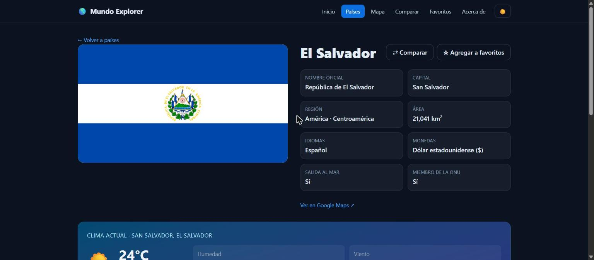
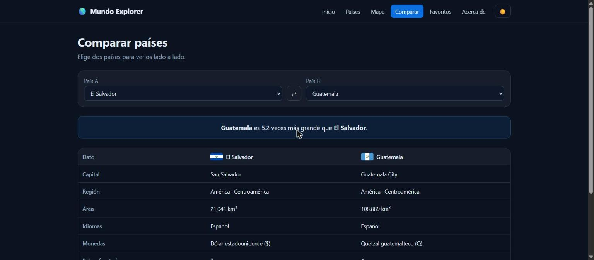
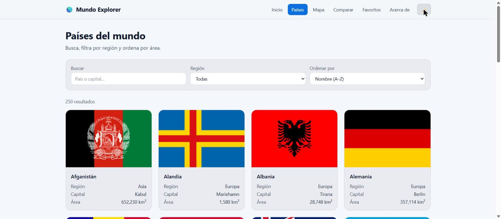
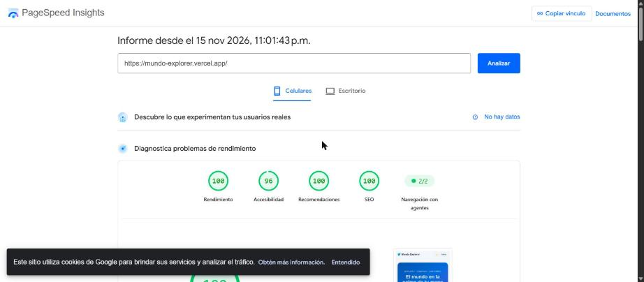

# 🌎 Mundo Explorer

[](https://github.com/alejandrocamposd17-beep/mundo-explorer/actions/workflows/ci.yml)

Aplicación web construida con **Next.js 16 (App Router)**, **TypeScript** y **Tailwind CSS v4** para explorar los países del mundo, ver el **clima actual y el pronóstico de 7 días de su capital**, ubicarlos en un **mapa interactivo**, **compararlos** lado a lado y guardar favoritos. Desarrollada con la metodología **Vibe Coding** (IA como copiloto de desarrollo).

- **Demo en producción:** https://mundo-explorer.vercel.app
- **Autor:** Alejandro Campos — Kodigo Academy (FSJ35)
- **Proceso de Vibe Coding:** ver [`VIBE_CODING.md`](./VIBE_CODING.md)

## 📸 Capturas

| Inicio | Detalle de país |
|---|---|
|  |  |
| **Pronóstico de 7 días** | **Mapa mundial (modo oscuro)** |
|  |  |
| **Comparador** | **Modo claro** |
|  |  |

**Vista previa al compartir el enlace (Open Graph):**


## ⚡ Rendimiento (Lighthouse / PageSpeed Insights)

| Rendimiento | Accesibilidad | Buenas prácticas | SEO |
|:---:|:---:|:---:|:---:|
| **100** | **96** | **100** | **100** |

Medido en producción con PageSpeed Insights (móvil y escritorio, 15 nov 2026), antes del rediseño visual.



## ✨ Funcionalidades

| Ruta | Tipo | Descripción |
|------|------|-------------|
| `/` | Server Component | Inicio con estadísticas globales y destinos destacados |
| `/paises` | Server + Client | 250 países con búsqueda (*debounce*, sin tildes), filtro por región, orden por área y paginación |
| `/paises/[code]` | Server + Client | Detalle en español, clima actual + pronóstico 7 días de la capital, mapa, fronteras y favoritos |
| `/mapa` | Server + Client | Mapa mundial interactivo (Leaflet + OpenStreetMap) con todos los países |
| `/comparar` | Server + Client | Compara dos países lado a lado (estado en la URL: `?a=slv&b=gtm`) |
| `/favoritos` | Client Component | Favoritos en `localStorage`, sincronizados entre pestañas |
| `/acerca` | Server Component | Información del proyecto y stack |
| `/aleatorio` | Route Handler | Redirige a un país al azar (botón «Sorpréndeme») |
| `/api/clima` | Route Handler | Proxy validado hacia Open-Meteo (actual + 7 días), con caché de 10 min |

Además: tipografía **Inter + Space Grotesk** (`next/font`), logo y favicon propios, hero animado, animaciones al hacer scroll y transiciones entre páginas (respetan «reducir movimiento»), brillo de fondo con los colores de cada bandera, **gráfica SVG del pronóstico**, insignias en las tarjetas (Sin litoral, ONU, Territorio…), prefijo telefónico, dominio y código ISO de cada país, **imágenes Open Graph** generadas por país, **modo claro/oscuro** (respeta la preferencia del sistema y se recuerda), datos traducidos al español (regiones, subregiones, idiomas y monedas) y diseño responsive con menú móvil.

**Requisitos cubiertos**

- ✅ 7 páginas + 2 Route Handlers con App Router
- ✅ APIs externas: dataset mledoze/countries y geocodificación de Open-Meteo (Server Components), clima de Open-Meteo (Route Handler `/api/clima`)
- ✅ Server Components y Client Components combinados
- ✅ Hooks `useState`, `useEffect`, `useMemo` y `useRef`
- ✅ Diseño responsive (mobile-first)
- ✅ `loading.tsx` (skeletons), `error.tsx` (con reintento) y `not-found.tsx`
- ✅ Variables de entorno con `.env.local` / `.env.example`

## 🧱 Estructura

```
app/
├── api/clima/route.ts      # Route Handler (GET /api/clima?lat=&lon=)
├── paises/                 # listado, [code] (detalle), loading y error
├── mapa/  comparar/  favoritos/  acerca/
├── layout.tsx · page.tsx · loading.tsx · error.tsx · not-found.tsx · globals.css
components/                 # Navbar, ThemeToggle, CountryCard, CountryExplorer, CountryMap,
                            # CompareSelector, WeatherWidget, FavoriteButton
lib/
├── countries.ts · geocoding.ts   # servicios de servidor (server-only)
├── normalize.ts · filter.ts · validation.ts · favorites.ts · weather.ts  # lógica pura y testeable
tests/                      # pruebas unitarias con Vitest
.github/workflows/ci.yml    # CI: lint, tipos, tests y build
```

## 🚀 Instalación y uso local

Requisitos: **Node.js 20.9+** y npm.

```bash
git clone https://github.com/alejandrocamposd17-beep/mundo-explorer.git
cd mundo-explorer
npm install
cp .env.example .env.local   # ajusta los valores si lo necesitas
npm run dev                  # http://localhost:3000
```

| Script | Descripción |
|--------|-------------|
| `npm run dev` | Servidor de desarrollo |
| `npm run build` / `npm start` | Build y servidor de producción |
| `npm run lint` | ESLint (config de Next.js + TypeScript) |
| `npm run typecheck` | Verificación de tipos con `tsc` |
| `npm test` | Pruebas unitarias con Vitest |

## ✅ Calidad

- **Pruebas unitarias (Vitest):** validación de coordenadas, búsqueda/filtros/orden, normalización y traducción de datos, y saneamiento de favoritos.
- **CI con GitHub Actions:** en cada push a `main` se ejecutan lint, chequeo de tipos, tests y build.
- **Despliegue continuo:** Vercel publica automáticamente cada commit en `main`.

## 🔐 Variables de entorno

| Variable | Ámbito | Descripción |
|----------|--------|-------------|
| `NEXT_PUBLIC_APP_NAME` | Cliente/Servidor | Nombre visible de la aplicación |
| `COUNTRIES_API_URL` | Solo servidor | URL del dataset JSON de países (mledoze/countries) |
| `WEATHER_API_URL` | Solo servidor | Endpoint de pronóstico de Open-Meteo |
| `GEOCODING_API_URL` | Solo servidor | Endpoint de geocodificación de Open-Meteo |

Ninguna API requiere clave. `.env.local` está en `.gitignore` y nunca se sube al repositorio.

## 🛡️ Seguridad

- **Content-Security-Policy** que solo permite scripts propios, imágenes de `flagcdn.com` y `tile.openstreetmap.org`, conexiones al mismo origen y prohíbe `<object>`, `<iframe>` externos y cambios de `base-uri`.
- Cabeceras HTTP: `X-Frame-Options: DENY`, `nosniff`, `Referrer-Policy`, HSTS, `Permissions-Policy`; sin `X-Powered-By`.
- Validación estricta de entradas: coordenadas en `/api/clima`, códigos de país (`^[A-Za-z]{3}$`) en rutas y en `/comparar`.
- URLs externas construidas con `URL`/`searchParams` y `encodeURIComponent`, nunca concatenando entrada del usuario.
- La respuesta de las APIs se valida antes de procesarse; el código ISO de 2 letras se verifica antes de armar la URL de la bandera.
- Errores internos no expuestos al cliente; timeouts en llamadas externas.
- Datos de `localStorage` validados al leerse (con pruebas unitarias).
- Tooltips del mapa insertados como texto (no HTML) para evitar XSS.
- `server-only` impide que los servicios del servidor lleguen al bundle del cliente.

## ☁️ Despliegue

Desplegado en **Vercel** con integración continua desde la rama `main` de GitHub. Para desplegar tu propia copia: importa el repositorio en Vercel, agrega las variables de `.env.example` en *Settings → Environment Variables* y despliega.

## 📄 Créditos de datos

- [mledoze/countries](https://github.com/mledoze/countries) — datos de países (fuente original de REST Countries)
- [Open-Meteo](https://open-meteo.com) — clima, pronóstico y geocodificación
- [Flagpedia / flagcdn](https://flagcdn.com) — banderas
- [OpenStreetMap](https://www.openstreetmap.org/copyright) + [Leaflet](https://leafletjs.com) — mapas
