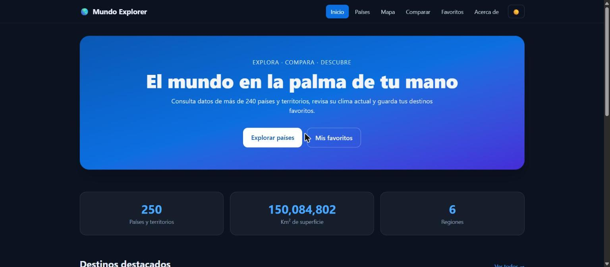
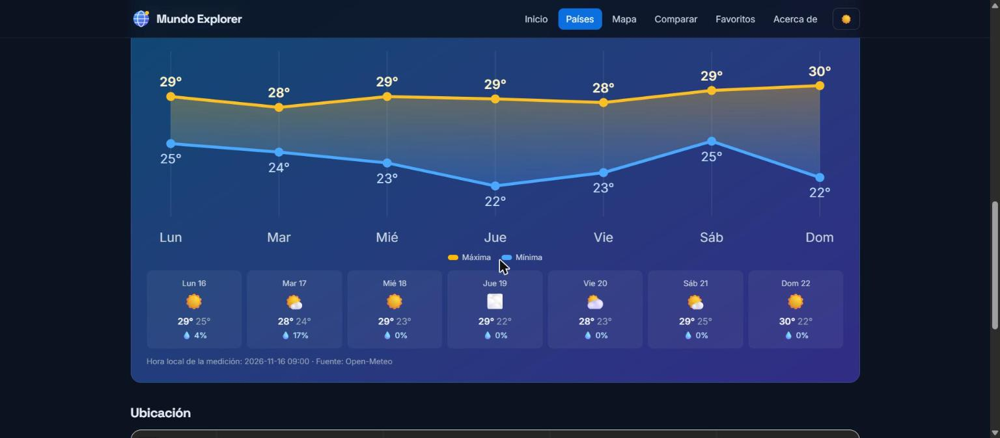
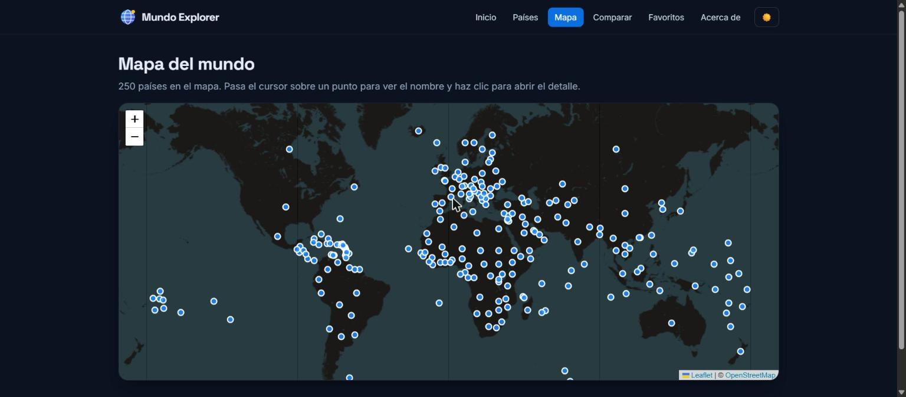
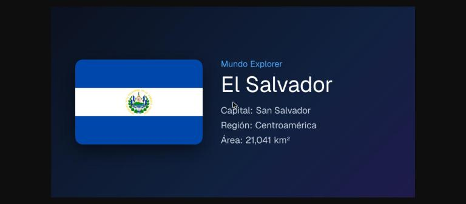

# 🌎 Mundo Explorer

[](https://github.com/alejandrocamposd17-beep/mundo-explorer/actions/workflows/ci.yml)

Aplicación web **bilingüe (español/inglés)** construida con **Next.js 16 (App Router)**, **TypeScript** y **Tailwind CSS v4** para explorar los países del mundo: **clima, pronóstico, calidad del aire y alertas** de su capital, **hora local**, resumen de **Wikipedia**, **mapa interactivo**, **comparador** con distancia y diferencia horaria, **rankings**, **juegos** de banderas y capitales, y **favoritos sincronizados en la nube** con Supabase. Es **instalable (PWA)** y funciona sin conexión. Desarrollada con la metodología **Vibe Coding** (IA como copiloto de desarrollo).

- **Demo en producción:** https://mundo-explorer.vercel.app
- **Autor:** Alejandro Campos — Kodigo Academy (FSJ35)
- **Proceso de Vibe Coding:** ver [`VIBE_CODING.md`](./VIBE_CODING.md)

## 📸 Capturas

| Inicio | Detalle de país |
|---|---|
|  |  |
| **Pronóstico de 7 días** | **Mapa mundial (modo oscuro)** |
|  |  |
| **Comparador** | **Modo claro** |
|  |  |

**Vista previa al compartir el enlace (Open Graph):**



## ⚡ Rendimiento (Lighthouse / PageSpeed Insights)

| Rendimiento | Accesibilidad | Buenas prácticas | SEO |
|:---:|:---:|:---:|:---:|
| **100** | **96** | **100** | **100** |

Medido en producción con PageSpeed Insights (móvil y escritorio, 15 nov 2026), antes del rediseño visual.


## ✨ Funcionalidades

| Ruta | Tipo | Descripción |
|------|------|-------------|
| `/` | Server Component | Inicio con hero animado, estadísticas y destinos destacados |
| `/paises` | Server + Client | 250 países con búsqueda, filtros por región, idioma, sin litoral y ONU, orden y paginación |
| `/paises/[code]` | Server + Client | Detalle: datos, Wikipedia, hora local, clima + aire + alertas + pronóstico, mapa, compartir |
| `/mapa` | Server + Client | Mapa mundial interactivo (Leaflet + OpenStreetMap, modo oscuro) |
| `/comparar` | Server + Client | Dos países lado a lado con distancia entre capitales y diferencia horaria |
| `/rankings` | Server Component | Más grandes, más pequeños, más fronteras y más idiomas |
| `/juegos` | Server + Client | «Adivina la bandera» y «Quiz de capitales» con niveles, racha y récord |
| `/favoritos` | Client Component | Favoritos en el navegador o sincronizados con tu cuenta |
| `/cuenta` | Client Component | Inicio de sesión sin contraseña (enlace mágico) con Supabase Auth |
| `/acerca` | Server Component | Información del proyecto y stack |
| `/api/clima` | Route Handler | Clima actual, 7 días y calidad del aire (Open-Meteo), validado y cacheado |
| `/api/paises` | Route Handler | Lista mínima de países para el buscador Ctrl+K |
| `/aleatorio` | Route Handler | Redirige a un país al azar (botón «Sorpréndeme») |

**Además:** idioma español/inglés (cookie + Server Components), buscador global **Ctrl+K**, modo claro/oscuro, tipografía Inter + Space Grotesk, animaciones que respetan «reducir movimiento», imágenes **Open Graph** por país, **PWA** con service worker y página sin conexión, y **Vercel Analytics**.

**Requisitos cubiertos**

- ✅ 11 páginas + 3 Route Handlers con App Router
- ✅ APIs externas: mledoze/countries, Open-Meteo (clima, aire, geocodificación), Wikipedia y Supabase (serverless)
- ✅ Server Components y Client Components combinados
- ✅ Hooks `useState`, `useEffect`, `useMemo` y `useRef`
- ✅ Diseño responsive (mobile-first)
- ✅ `loading.tsx` (skeletons), `error.tsx` (con reintento) y `not-found.tsx`
- ✅ Variables de entorno con `.env.local` / `.env.example`

## 🧱 Estructura

```
app/                        # rutas (App Router), API, manifest e imágenes Open Graph
components/                 # Navbar, CommandPalette, QuizGame, WeatherWidget, CountryMap, ShareButton…
lib/
├── i18n/                   # diccionarios es/en, getLocale (servidor) y useI18n (cliente)
├── countries.ts · geocoding.ts · wikipedia.ts   # servicios de servidor (server-only)
├── normalize.ts · filter.ts · quiz.ts · geo.ts · weather.ts · validation.ts  # lógica pura y testeable
├── supabase.ts · cloudFavorites.ts · favorites.ts                         # favoritos local + nube
public/sw.js · public/offline.html                # PWA sin conexión
supabase/schema.sql         # tabla de favoritos con RLS
tests/                      # Vitest (unitarias)
e2e/                        # Playwright (extremo a extremo, escritorio y móvil)
.github/workflows/ci.yml    # CI: lint, tipos, tests, build y e2e
```

## 🚀 Instalación y uso local

Requisitos: **Node.js 20.9+** y npm.

```bash
git clone https://github.com/alejandrocamposd17-beep/mundo-explorer.git
cd mundo-explorer
npm install
cp .env.example .env.local   # ajusta los valores si lo necesitas
npm run dev                  # http://localhost:3000
```

| Script | Descripción |
|--------|-------------|
| `npm run dev` | Servidor de desarrollo |
| `npm run build` / `npm start` | Build y servidor de producción |
| `npm run lint` | ESLint (config de Next.js + TypeScript) |
| `npm run typecheck` | Verificación de tipos con `tsc` |
| `npm test` | Pruebas unitarias con Vitest |
| `npm run test:e2e` | Pruebas de extremo a extremo con Playwright (requiere `npm run build`) |

## ✅ Calidad

- **Pruebas unitarias (Vitest):** validación de coordenadas, búsqueda/filtros/orden, normalización y traducción de datos, y saneamiento de favoritos.
- **Pruebas de extremo a extremo (Playwright):** 11 escenarios en escritorio y móvil (búsqueda, detalle, favoritos, comparador, idioma, juego, Ctrl+K, rankings, API y 404).
- **CI con GitHub Actions:** en cada push a `main` se ejecutan lint, chequeo de tipos, tests unitarios, build y e2e.
- **Despliegue continuo:** Vercel publica automáticamente cada commit en `main`.

## 🔐 Variables de entorno

| Variable | Ámbito | Descripción |
|----------|--------|-------------|
| `NEXT_PUBLIC_APP_NAME` | Cliente/Servidor | Nombre visible de la aplicación |
| `COUNTRIES_API_URL` | Solo servidor | URL del dataset JSON de países (mledoze/countries) |
| `WEATHER_API_URL` | Solo servidor | Endpoint de pronóstico de Open-Meteo |
| `GEOCODING_API_URL` | Solo servidor | Endpoint de geocodificación de Open-Meteo |
| `AIR_QUALITY_API_URL` | Solo servidor | Endpoint de calidad del aire de Open-Meteo |
| `NEXT_PUBLIC_SITE_URL` | Cliente/Servidor | URL pública (Open Graph) |
| `NEXT_PUBLIC_SUPABASE_URL` | Cliente | URL del proyecto de Supabase (opcional) |
| `NEXT_PUBLIC_SUPABASE_ANON_KEY` | Cliente | Clave pública de Supabase; la seguridad la da RLS (opcional) |

Las APIs de datos no requieren clave. Supabase es opcional: sin sus variables, la app guarda los favoritos en el navegador. `.env.local` está en `.gitignore` y nunca se sube al repositorio.

### Configurar Supabase (favoritos en la nube)

1. Crea un proyecto en Supabase y ejecuta `supabase/schema.sql` en el SQL Editor.
2. En *Authentication → URL Configuration* pon tu dominio como Site URL y agrega `https://tu-dominio/cuenta` a Redirect URLs.
3. Agrega `NEXT_PUBLIC_SUPABASE_URL` y `NEXT_PUBLIC_SUPABASE_ANON_KEY` en `.env.local` y en Vercel.

## 🛡️ Seguridad

- **Content-Security-Policy** con lista blanca: imágenes de `flagcdn.com`, OpenStreetMap y `upload.wikimedia.org`; conexiones solo al mismo origen y a Supabase; sin `<object>`, `<iframe>` externos ni cambios de `base-uri`.
- **Supabase con Row Level Security:** cada usuario solo puede leer y modificar sus propios favoritos; restricciones `CHECK` en la tabla y límite de 100 por usuario. Inicio de sesión sin contraseñas (enlace mágico).
- Resúmenes de Wikipedia: solo se aceptan imágenes de `upload.wikimedia.org` y enlaces de `wikipedia.org`; zonas horarias IANA validadas antes de usarse.
- El service worker no cachea `/cuenta` ni respuestas de otros orígenes (salvo banderas).
- Cabeceras HTTP: `X-Frame-Options: DENY`, `nosniff`, `Referrer-Policy`, HSTS, `Permissions-Policy`; sin `X-Powered-By`.
- Validación estricta de entradas: coordenadas en `/api/clima`, códigos de país (`^[A-Za-z]{3}$`) en rutas y en `/comparar`.
- URLs externas construidas con `URL`/`searchParams` y `encodeURIComponent`, nunca concatenando entrada del usuario.
- La respuesta de las APIs se valida antes de procesarse; el código ISO de 2 letras se verifica antes de armar la URL de la bandera.
- Errores internos no expuestos al cliente; timeouts en llamadas externas.
- Datos de `localStorage` validados al leerse (con pruebas unitarias).
- Tooltips del mapa insertados como texto (no HTML) para evitar XSS.
- `server-only` impide que los servicios del servidor lleguen al bundle del cliente.

## ☁️ Despliegue

Desplegado en **Vercel** con integración continua desde la rama `main` de GitHub. Para desplegar tu propia copia: importa el repositorio en Vercel, agrega las variables de `.env.example` en *Settings → Environment Variables* y despliega.

## 📄 Créditos de datos

- [mledoze/countries](https://github.com/mledoze/countries) — datos de países (fuente original de REST Countries)
- [Open-Meteo](https://open-meteo.com) — clima, pronóstico, calidad del aire y geocodificación
- [Wikipedia](https://www.wikipedia.org) — resúmenes y fotos (CC BY-SA)
- [Supabase](https://supabase.com) — autenticación y base de datos
- [Flagpedia / flagcdn](https://flagcdn.com) — banderas
- [OpenStreetMap](https://www.openstreetmap.org/copyright) + [Leaflet](https://leafletjs.com) — mapas
